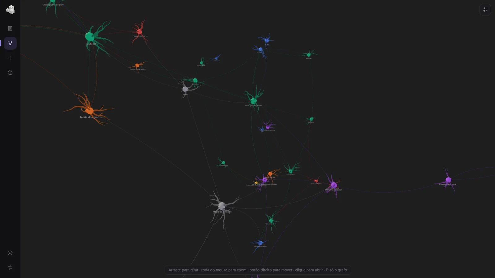
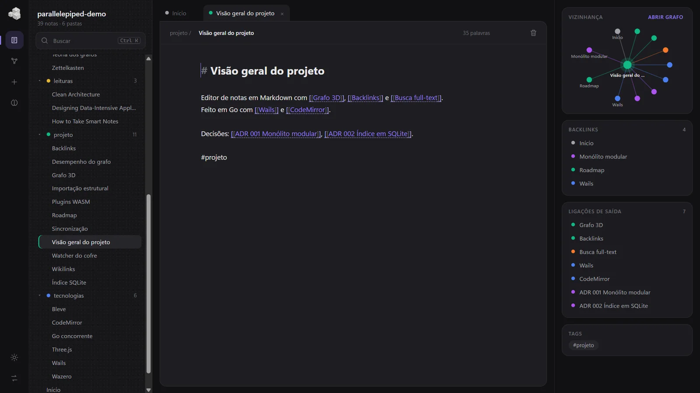

# parallelepiped

Editor de notas em Markdown para desktop, com links entre notas, backlinks,
busca de texto completo e um **grafo 3D** que você gira com o mouse.

Um cofre é uma pasta comum: as notas são arquivos `.md` que continuam
legíveis por qualquer outro editor.





## Requisitos

- Go 1.26+
- Node.js 22+ e npm
- WebView2 (já vem no Windows 10/11)
- GNU make (opcional, para os atalhos abaixo)

## Primeiros passos

```bash
make tools   # instala o Wails CLI v2.16.0
make deps    # baixa módulos Go e pacotes do frontend
make dev     # abre o app com hot reload
```

`make help` lista todos os alvos. Os principais:

| Alvo | O que faz |
|---|---|
| `make dev` | roda o app com hot reload |
| `make build` | gera `build/bin/parallelepiped.exe` |
| `make check` | `go vet`, testes Go e checagem de tipos do frontend |
| `make bindings` | regenera os bindings TypeScript em `frontend/wailsjs` |

## Atalhos

| Tecla | Ação |
|---|---|
| Ctrl+N | nova nota |
| Ctrl+G | alterna entre editor e grafo 3D |
| Ctrl+K ou Ctrl+Shift+F | busca |
| F / Esc (no grafo) | entra e sai do modo só-grafo |
| Ctrl+S | salva agora (o salvamento também é automático) |
| Ctrl+clique em `[[link]]` | abre a nota (ou cria, se não existir) |

No grafo: arraste para girar, use a roda para zoom, botão direito para mover e
clique num nó para abrir a nota.

## Arquitetura

Monolito modular em camadas — veja [docs/ARCHITECTURE.md](docs/ARCHITECTURE.md).

## Contribuindo

Contribuições são bem-vindas. Leia o [guia de contribuição](CONTRIBUTING.md) e
o [código de conduta](CODE_OF_CONDUCT.md). Para relatar uma vulnerabilidade,
siga a [política de segurança](SECURITY.md) — não abra uma issue pública.

## Licença

[MIT](LICENSE) © 2026 Gabriel Alves de Araujo.
